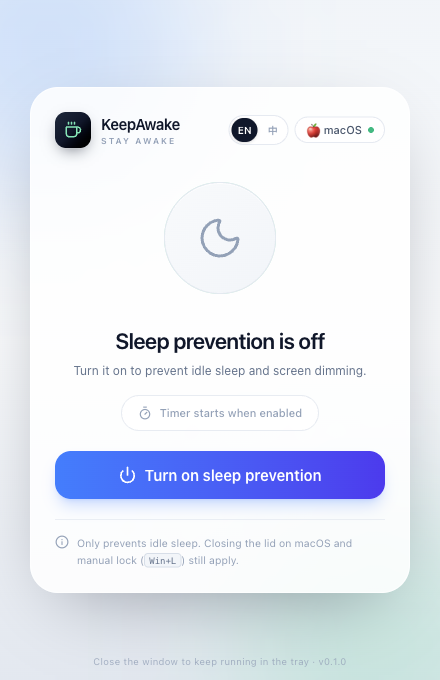
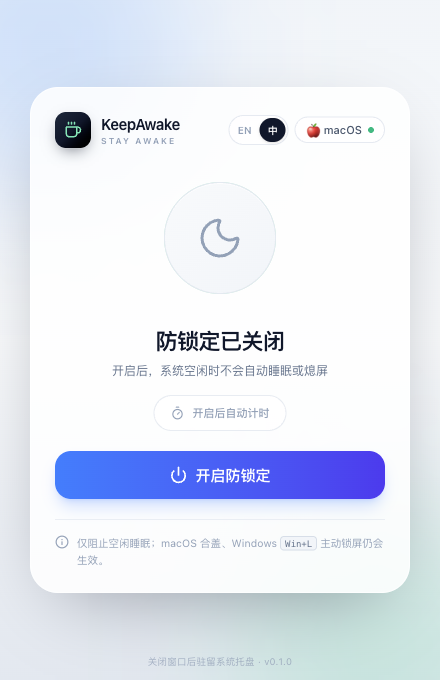
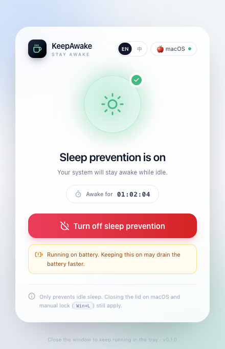
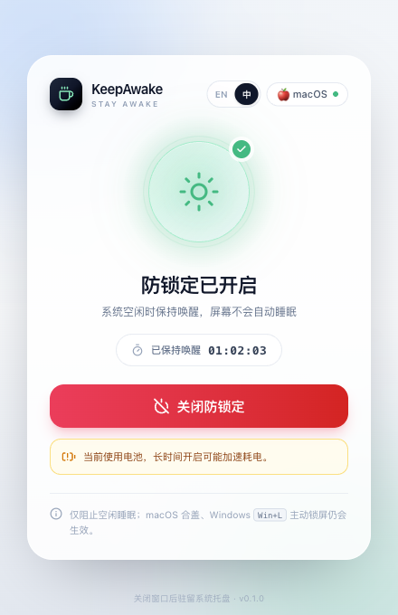

# KeepAwake

一个轻量、极简、无干扰的跨平台防锁定工具。自动识别 Windows / macOS，并调用系统原生防休眠机制阻止电脑因空闲而睡眠或熄屏。支持中英文切换，首次启动默认英文。

> 不使用模拟鼠标点击 / 按键等“流氓”手段，不干扰全屏游戏、视频会议和挂机任务。

| English (default) | 中文 |
| :---: | :---: |
|  |  |
|  |  |

> 顶栏 `EN / 中` 可即时切换界面语言；首次启动默认英文，选择会保存在本地。


## 功能

- **跨平台检测**：启动时识别系统，界面顶部展示平台徽章。
- **一键防锁定**：主按钮开启 / 关闭，底层自动路由到对应平台实现。
- **状态与计时**：实时展示状态和 `HH:MM:SS` 保持时长。
- **系统托盘**：关闭窗口自动隐藏到托盘；托盘菜单支持显示主界面、动态开关、退出。
- **托盘图标联动**：关闭态灰色月亮，开启态绿色太阳。
- **电池提示**：检测到电池供电时展示耗电警告，插拔电源后自动刷新。
- **退出清理**：任何退出路径都会终止 `caffeinate` / 恢复 Windows 执行状态。
- **中英文切换**：顶栏 `EN / 中` 即时切换；首次启动默认英文，选择会持久化，原生托盘菜单同步更新。
- **浅色 / 深色**：跟随系统外观，固定窗口、卡片式单页布局。

## 技术栈

| 层 | 技术 |
| --- | --- |
| 前端 | React 19 + TypeScript 7 + Vite 8 |
| 样式 | Tailwind CSS 4 |
| 图标 | Lucide React |
| 桌面框架 | Tauri 2 |
| 后端 | Rust |
| Windows API | `windows` crate · `Win32_System_Power` |
| macOS API | 系统内置 `caffeinate` |

## 平台实现

### macOS

开启时派生系统自带进程：

```text
/usr/bin/caffeinate -dis -w <KeepAwake PID>
```

- `-d`：阻止显示器休眠
- `-i`：阻止系统空闲休眠
- `-s`：阻止系统睡眠
- `-w <pid>`：KeepAwake 进程退出后自动结束，避免残留

关闭或退出时主动 `kill` 并 `wait` 该子进程。

### Windows

在独立线程中调用 Win32 API：

```rust
SetThreadExecutionState(ES_CONTINUOUS | ES_SYSTEM_REQUIRED | ES_DISPLAY_REQUIRED);
```

`SetThreadExecutionState` 的生效范围是调用线程，因此守护线程会在开启期间持续存活；关闭时由**同一线程**调用 `ES_CONTINUOUS` 恢复系统默认策略。

### 电池检测

- macOS：解析 `pmset -g batt` 的 `AC Power` / `Battery Power`。
- Windows：`GetSystemPowerStatus` 的 `ACLineStatus`。

## 目录结构

```text
keep-awake/
├── src/                         # React 前端
│   ├── App.tsx                  # 主页面
│   ├── main.tsx                 # 入口
│   ├── index.css                # Tailwind + 动效
│   ├── components/              # 状态球、平台徽章、语言切换、按钮、电池提示
│   ├── hooks/useKeepAwake.ts    # 状态 / 计时 / 事件订阅
│   ├── i18n/                    # 中英文文案与语言 Provider
│   └── lib/                     # IPC 封装、格式化、错误码映射、单测
├── src-tauri/
│   ├── src/
│   │   ├── main.rs              # Tauri 初始化、窗口关闭与退出清理
│   │   ├── i18n.rs              # 语言枚举与托盘文案
│   │   ├── error.rs             # 可本地化的结构化错误码
│   │   ├── platform/
│   │   │   ├── mod.rs           # 平台检测与路由
│   │   │   ├── windows.rs       # SetThreadExecutionState
│   │   │   └── macos.rs         # caffeinate / pmset
│   │   ├── state.rs             # 状态机、计时、互斥锁
│   │   ├── commands.rs          # IPC 命令
│   │   └── tray.rs              # 托盘图标与菜单
│   ├── Cargo.toml
│   ├── tauri.conf.json
│   ├── capabilities/default.json
│   └── icons/                   # 应用图标 + 两套托盘图标
├── scripts/generate_icons.py    # 图标再生成脚本
├── package.json
├── vite.config.ts
└── tsconfig.json
```

> Tailwind 4 采用 CSS-first 配置，主题与动效集中在 `src/index.css`，因此不再需要 `tailwind.config.js`。

## 开发

前置依赖：Node.js ≥ 20、Rust stable、Xcode Command Line Tools（macOS）或 MSVC Build Tools + WebView2（Windows）。

```bash
npm install
npm run tauri dev        # 启动桌面应用（Vite + Tauri）
```

仅调试前端：

```bash
npm run dev              # http://localhost:1420
```

## 多语言

- 文案：`src/i18n/messages.ts`，英文是 key 来源，中文由 `Record<MessageKey, string>` 强制补齐。
- 语言状态：`src/i18n/index.tsx`，默认 `en`，选择保存在 `localStorage` 的 `keepawake.language`。
- 原生托盘：Rust `src-tauri/src/i18n.rs`；前端切换时调用 `set_language` 命令同步菜单与提示语。
- 错误：后端返回稳定错误码（`src-tauri/src/error.rs`），前端在 `src/lib/errors.ts` 映射为当前语言文案。

## 构建

```bash
npm run tauri build
```

产物位置：

- macOS：`src-tauri/target/release/bundle/macos/KeepAwake.app`、`dmg/`
- Windows：`src-tauri/target/release/bundle/msi/`、`nsis/`

如果只需要 `.app`（跳过 DMG 打包），可执行：

```bash
npm run tauri build -- --bundles app
```

当前 macOS arm64 的 `.app` 体积约 **4.74 MB**，满足 `< 10MB` 的安装包预算。

## 测试

```bash
npm test                              # 前端格式化 / 错误码映射 / 文案完整性单测
cd src-tauri && cargo test            # Rust 平台、caffeinate、语言与错误测试
cd src-tauri && cargo check           # 编译检查
```

## 验证

- macOS arm64 release `.app` 体积 **4.74 MiB**。
- 前端 13 个单测、Rust 8 个单测全部通过，`cargo clippy --all-targets -- -D warnings` 无告警。
- 默认英文；`EN / 中` 切换即时生效并持久化，原生托盘菜单语言同步。
- 开启后 `pmset -g assertions` 可见 `caffeinate` 的 `PreventUserIdleSystemSleep` / `PreventUserIdleDisplaySleep` 断言。
- 结束主进程后，`caffeinate -w` 会自动退出，不残留防休眠状态。

## 已知限制

- macOS 的防休眠仅阻止**空闲睡眠**；合上盖子后系统仍会睡眠。
- 用户主动锁屏（Windows `Win+L`、macOS 锁屏）不会被阻止。
- 应用需要常驻后台（托盘）才能维持防锁定；托盘“退出”会立即恢复系统策略。
- Windows 实现已按 `windows` 0.62 API 编写并通过 API 签名核对；最终安装包需在 Windows 环境执行构建验证。

## 重新生成图标

```bash
python3 scripts/generate_icons.py          # 需要 Pillow + numpy
npx tauri icon src-tauri/icons/source.png  # 生成各平台图标尺寸
```

应用图标按 macOS 标准图标网格生成：1024 画布内实际圆角内容为 824×824，四周保留 100px 透明边距，并在最后按圆角遮罩裁剪所有图层，避免启动台中图标偏大或出现方角阴影。
